# Bug Report – HW04 Automation (23120398)

All defects below are detected by **failing assertions** in the automated suite and reproduce on **Chromium, Firefox and WebKit**. Each failing data row is tagged with its bug id (`"bugs": [...]` in `data/*.json`) and runs as `test.fail()`, so the HTML reports list it as an expected failure with the issue link.

Evidence runs: `fr03-chromium` (2026-11-18T03:28:27.518Z), `fr03-firefox` (2026-11-18T03:29:21.371Z), `fr03-webkit` (2026-11-18T03:31:36.551Z), `fr08-chromium` (2026-11-18T03:32:56.392Z), `fr08-firefox` (2026-11-18T03:33:54.478Z), `fr08-webkit` (2026-11-18T03:35:26.402Z), `fr16-chromium` (2026-11-18T03:36:45.790Z), `fr16-firefox` (2026-11-18T03:37:39.196Z), `fr16-webkit` (2026-11-18T03:39:09.041Z).

## Summary

| Bug ID | Feature | Severity | Title | Failing tests | HW04 issue | HW02 reference |
|---|---|---|---|---|---|---|
| BUG-FR03-001 | FR-03 | Critical | Password reset regex rejects valid special characters and requires whitespace | TC01, TC14, TC23, BVA02, BVA03, BVA04, BVA05, BVA06, BVA07 | _pending_ | [HW02](https://github.com/NguyenSonTung16/HW02/issues/25) |
| BUG-FR03-002 | FR-03 | Critical | OTP generator issues 4-digit tokens instead of 6 digits | BVA09, TC18 | _pending_ | [HW02](https://github.com/NguyenSonTung16/HW02/issues/26) |
| BUG-FR03-003 | FR-03 | Critical | Backend /api/reset-password does not validate the password policy | TC21 | _pending_ | [HW02](https://github.com/NguyenSonTung16/HW02/issues/27) |
| BUG-FR03-004 | FR-03 | Medium | Step 2 has no "Confirm New Password" field | TC15 | _pending_ | [HW02](https://github.com/NguyenSonTung16/HW02/issues/28) |
| BUG-FR03-005 | FR-03 | Low | No step indicator and no "Back to Login" control | TC16, TC17 | _pending_ | [HW02](https://github.com/NguyenSonTung16/HW02/issues/29) |
| BUG-FR08-001 | FR-08 | Critical | Backend trusts client-supplied total_amount (0, negative, tampered) | TC04, TC05, TC06, BVA05 | _pending_ | [HW02](https://github.com/NguyenSonTung16/HW02/issues/30) |
| BUG-FR08-002 | FR-08 | Critical | Grand total is an editable number input on the checkout page | TC01, TC04 | _pending_ | [HW02](https://github.com/NguyenSonTung16/HW02/issues/31) |
| BUG-FR08-003 | FR-08 | High | Guest can open /checkout without logging in | TC02 | _pending_ | [HW02](https://github.com/NguyenSonTung16/HW02/issues/32) |
| BUG-FR08-004 | FR-08 | Medium | Cart is not cleared after a successful checkout | TC01, TC07 | _pending_ | [HW02](https://github.com/NguyenSonTung16/HW02/issues/33) |
| BUG-FR16-001 | FR-16 | Critical | CSV import is not atomic – valid rows are kept when another row fails | TC06 | _pending_ | [HW02](https://github.com/NguyenSonTung16/HW02/issues/34) |
| BUG-FR16-002 | FR-16 | Critical | CSV parser splits quoted fields on commas (RFC 4180) | TC03 | _pending_ | [HW02](https://github.com/NguyenSonTung16/HW02/issues/35) |
| BUG-FR16-003 | FR-16 | High | CSV import accepts zero and negative prices | TC05, BVA01, BVA02 | _pending_ | [HW02](https://github.com/NguyenSonTung16/HW02/issues/36) |
| BUG-FR16-004 | FR-16 | Low | File input has no accept=".csv" restriction | TC02 | _pending_ | [HW02](https://github.com/NguyenSonTung16/HW02/issues/37) |
| BUG-FR16-005 | FR-16 | Critical | Import API accepts any logged-in user token (no admin role check) – NEW in HW04 | TC11 | _pending_ | **new** |

Total: **14** bugs (1 new in HW04). Critical: 8, High: 2, Medium: 2, Low: 2.

## BUG-FR03-001 – Password reset regex rejects valid special characters and requires whitespace

- **Feature / component:** FR-03 – Frontend Web (ForgotPassword.jsx)
- **Severity:** Critical
- **GitHub issue:** _pending_ (first reported in HW02: https://github.com/NguyenSonTung16/HW02/issues/25)
- **Detected by:** `TC01`, `TC14`, `TC23`, `BVA02`, `BVA03`, `BVA04`, `BVA05`, `BVA06`, `BVA07` in `tests/fr03-*.spec.ts`

**Steps to reproduce**

1. Open /forgot-password, enter a registered email, click "Lấy mã OTP"
2. Enter the OTP shown on screen and the new password `Reset@2026`
3. Click "Đặt lại mật khẩu"

**Expected:** Password accepted (≥ 8 chars, upper, lower, digit, one of @$!%*?&); alert "Đổi mật khẩu thành công!" and redirect to /login.

**Actual:** Alert "Mật khẩu quá yếu!…" for every allowed special character (TC23: 0/7 accepted) and for lengths 8–65. `Reset 2026` (space as the special char) is accepted (TC14).

**Root cause:** `/^(?=.*[a-z])(?=.*[A-Z])(?=.*\d)(?=.*\s)[A-Za-z\d\s]{8,}$/` requires `\s` and forbids every symbol.

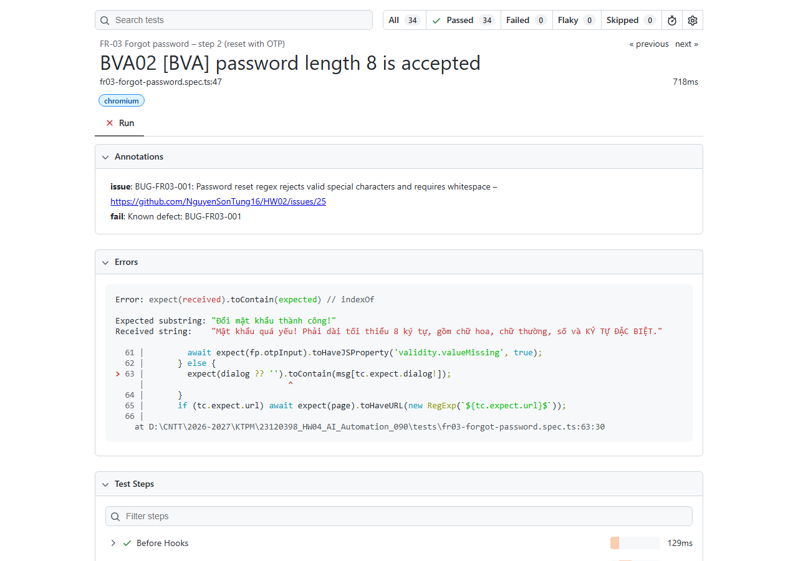

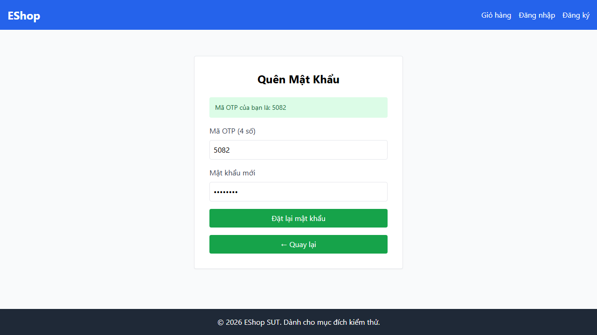

## BUG-FR03-002 – OTP generator issues 4-digit tokens instead of 6 digits

- **Feature / component:** FR-03 – Backend API (/api/forgot-password)
- **Severity:** Critical
- **GitHub issue:** _pending_ (first reported in HW02: https://github.com/NguyenSonTung16/HW02/issues/26)
- **Detected by:** `BVA09`, `TC18` in `tests/fr03-*.spec.ts`

**Steps to reproduce**

1. POST /api/forgot-password {email} (or request OTP on /forgot-password) 20 times

**Expected:** Every OTP is a 6-digit number 000000–999999.

**Actual:** All 20 samples have 4 digits (e.g. 2668, 3581); UI label also says "Mã OTP (4 số)".

**Root cause:** `Math.floor(1000 + Math.random() * 9000)`.

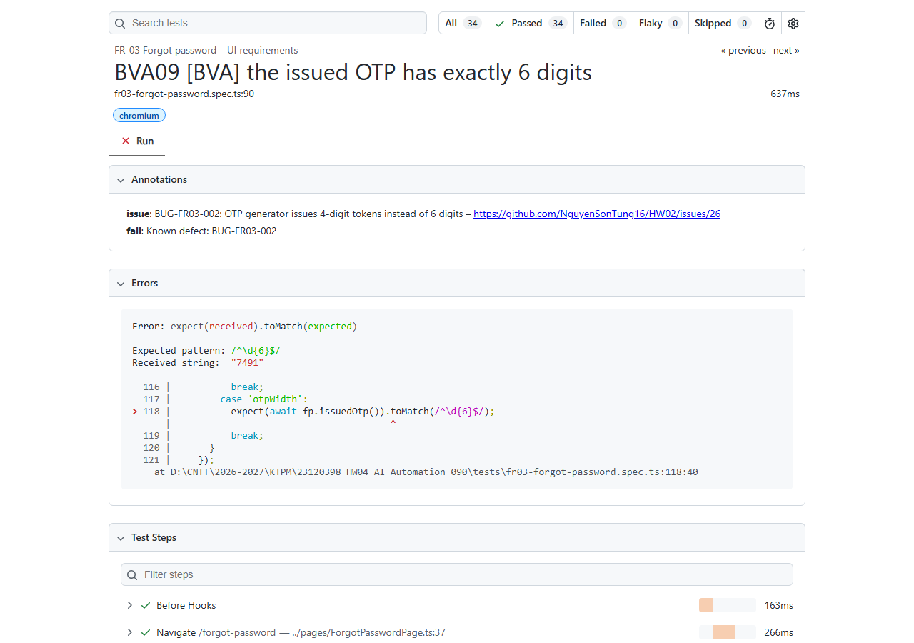

## BUG-FR03-003 – Backend /api/reset-password does not validate the password policy

- **Feature / component:** FR-03 – Backend API (/api/reset-password)
- **Severity:** Critical
- **GitHub issue:** _pending_ (first reported in HW02: https://github.com/NguyenSonTung16/HW02/issues/27)
- **Detected by:** `TC21` in `tests/fr03-*.spec.ts`

**Steps to reproduce**

1. Request an OTP via API
2. POST /api/reset-password {email, resetToken, newPassword: "123"}

**Expected:** HTTP 400; password unchanged.

**Actual:** HTTP 200; login with "123" succeeds. The only policy check is in the (buggy) client.

**Root cause:** Route updates the password without any validation.

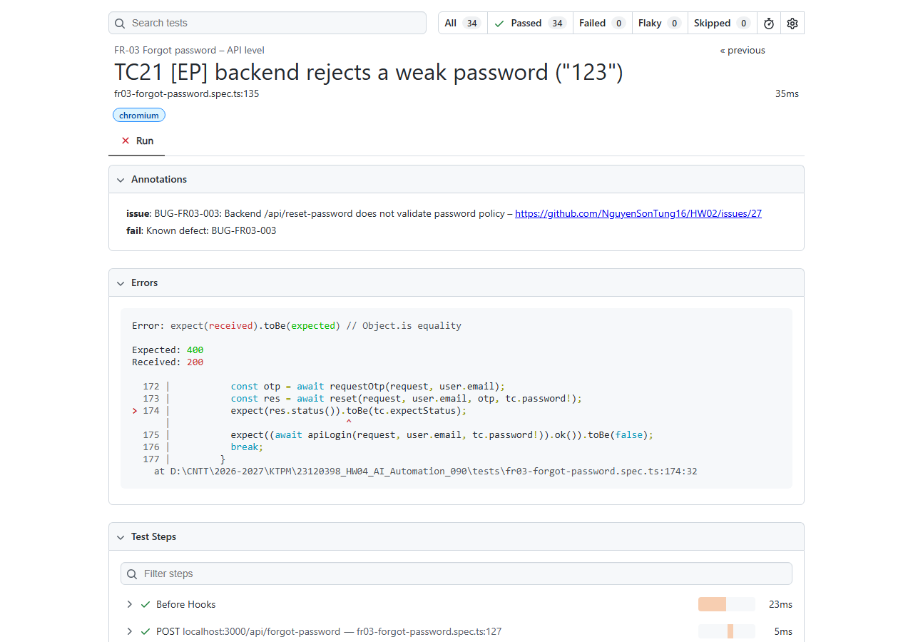

## BUG-FR03-004 – Step 2 has no "Confirm New Password" field

- **Feature / component:** FR-03 – Frontend Web (ForgotPassword.jsx)
- **Severity:** Medium
- **GitHub issue:** _pending_ (first reported in HW02: https://github.com/NguyenSonTung16/HW02/issues/28)
- **Detected by:** `TC15` in `tests/fr03-*.spec.ts`

**Steps to reproduce**

1. Request an OTP on /forgot-password
2. Inspect step 2 form

**Expected:** Two password inputs (new + confirm) and a mismatch error.

**Actual:** Only one password input exists (`input[type=password]` count = 1).

**Root cause:** Field not implemented.

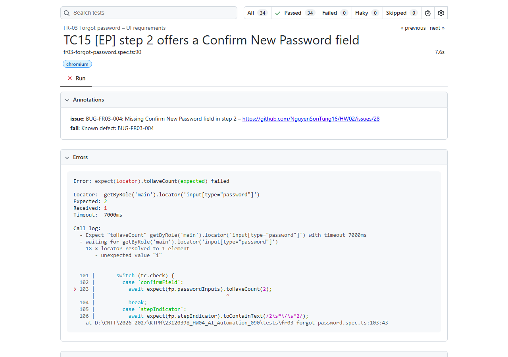

## BUG-FR03-005 – No step indicator and no "Back to Login" control

- **Feature / component:** FR-03 – Frontend Web (ForgotPassword.jsx)
- **Severity:** Low
- **GitHub issue:** _pending_ (first reported in HW02: https://github.com/NguyenSonTung16/HW02/issues/29)
- **Detected by:** `TC16`, `TC17` in `tests/fr03-*.spec.ts`

**Steps to reproduce**

1. Open /forgot-password and request an OTP

**Expected:** "Step 1 / 2" / "Step 2 / 2" indicator and a link back to /login.

**Actual:** No indicator; only "← Quay lại" (back to step 1) exists.

**Root cause:** Not implemented.

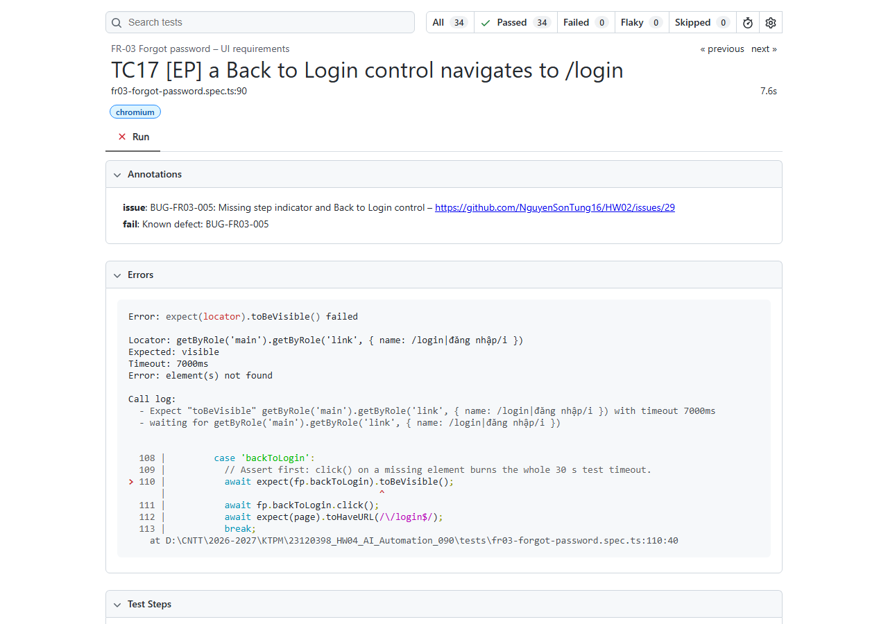

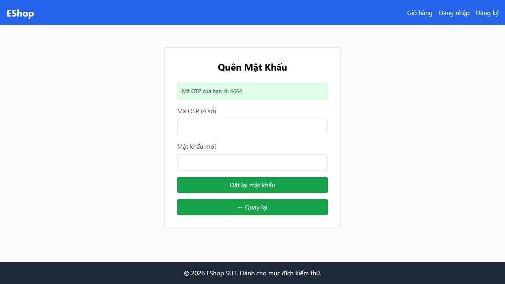

## BUG-FR08-001 – Backend trusts client-supplied total_amount (0, negative, tampered)

- **Feature / component:** FR-08 – Backend API (/api/checkout)
- **Severity:** Critical
- **GitHub issue:** _pending_ (first reported in HW02: https://github.com/NguyenSonTung16/HW02/issues/30)
- **Detected by:** `TC04`, `TC05`, `TC06`, `BVA05` in `tests/fr08-*.spec.ts`

**Steps to reproduce**

1. Log in, add iPhone 15 Pro Max ×1, open checkout
2. Change "Tổng tiền thanh toán" to 1 and confirm (or POST /api/checkout with total_amount 0 / -500000 / quantity 0)

**Expected:** Server recalculates 30,000,000 ₫ (or rejects with 400).

**Actual:** Order stored with total_amount = 1 / 0 / -500000; quantity 0 accepted (HTTP 200).

**Root cause:** Route inserts `total_amount` from the request body; items are ignored.

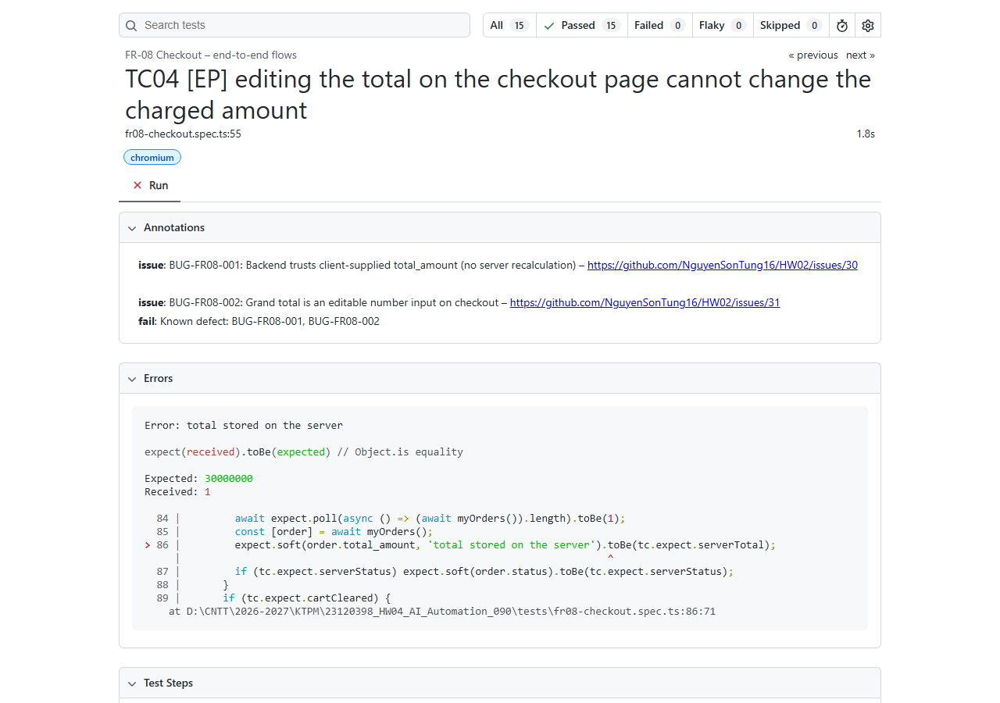

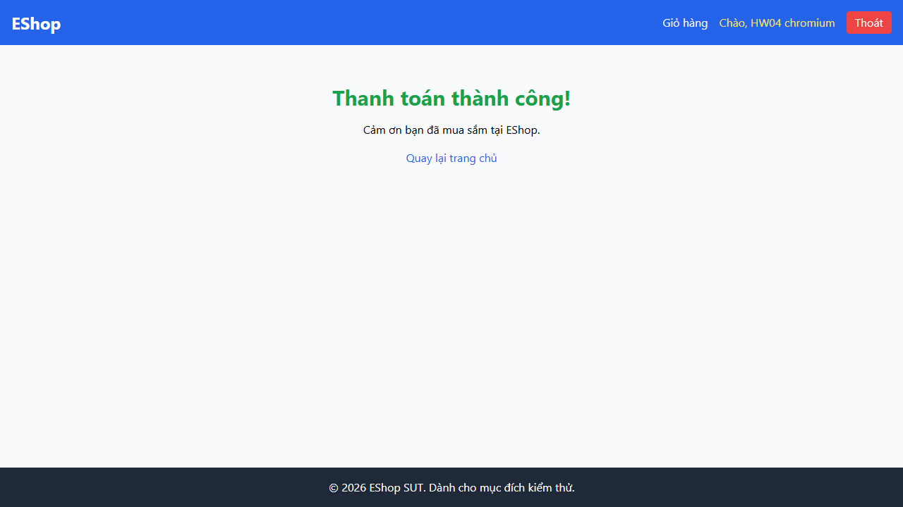

## BUG-FR08-002 – Grand total is an editable number input on the checkout page

- **Feature / component:** FR-08 – Frontend Web (Checkout.jsx)
- **Severity:** Critical
- **GitHub issue:** _pending_ (first reported in HW02: https://github.com/NguyenSonTung16/HW02/issues/31)
- **Detected by:** `TC01`, `TC04` in `tests/fr08-*.spec.ts`

**Steps to reproduce**

1. Log in, add items, open /checkout

**Expected:** Total displayed read-only.

**Actual:** `<input type="number">` editable (Playwright `not.toBeEditable()` fails).

**Root cause:** `editableTotal` state bound to an input.

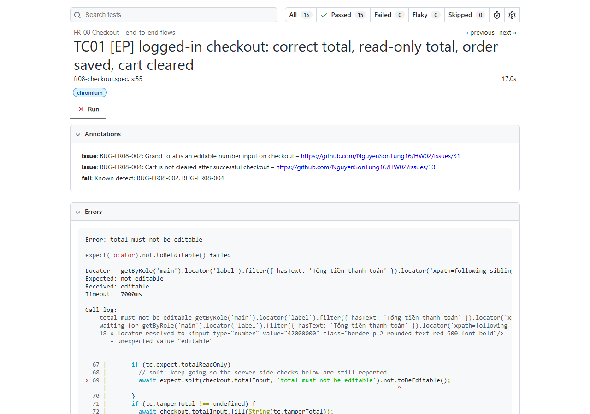

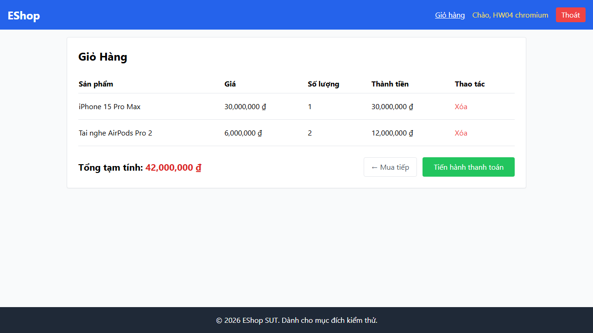

## BUG-FR08-003 – Guest can open /checkout without logging in

- **Feature / component:** FR-08 – Frontend Web (routing)
- **Severity:** High
- **GitHub issue:** _pending_ (first reported in HW02: https://github.com/NguyenSonTung16/HW02/issues/32)
- **Detected by:** `TC02` in `tests/fr08-*.spec.ts`

**Steps to reproduce**

1. As a guest (header shows "Đăng nhập"), open http://localhost:5173/checkout

**Expected:** Redirect to /login.

**Actual:** Checkout page is rendered at /checkout.

**Root cause:** No route guard; only the cart button checks `user`.

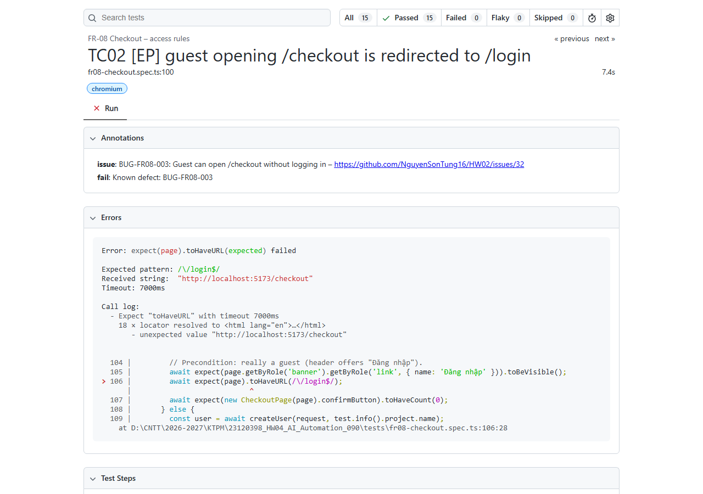

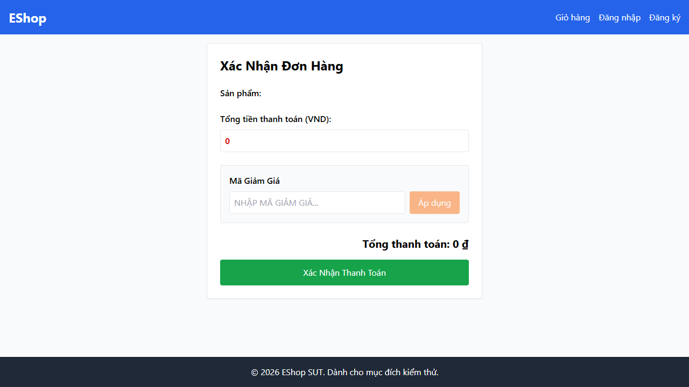

## BUG-FR08-004 – Cart is not cleared after a successful checkout

- **Feature / component:** FR-08 – Frontend Web (Checkout.jsx)
- **Severity:** Medium
- **GitHub issue:** _pending_ (first reported in HW02: https://github.com/NguyenSonTung16/HW02/issues/33)
- **Detected by:** `TC01`, `TC07` in `tests/fr08-*.spec.ts`

**Steps to reproduce**

1. Log in, add a product, checkout until "Thanh toán thành công!"
2. Click "Giỏ hàng"

**Expected:** "Giỏ hàng của bạn đang trống".

**Actual:** The purchased items are still in the cart.

**Root cause:** `clearCart()` is never called after checkout.

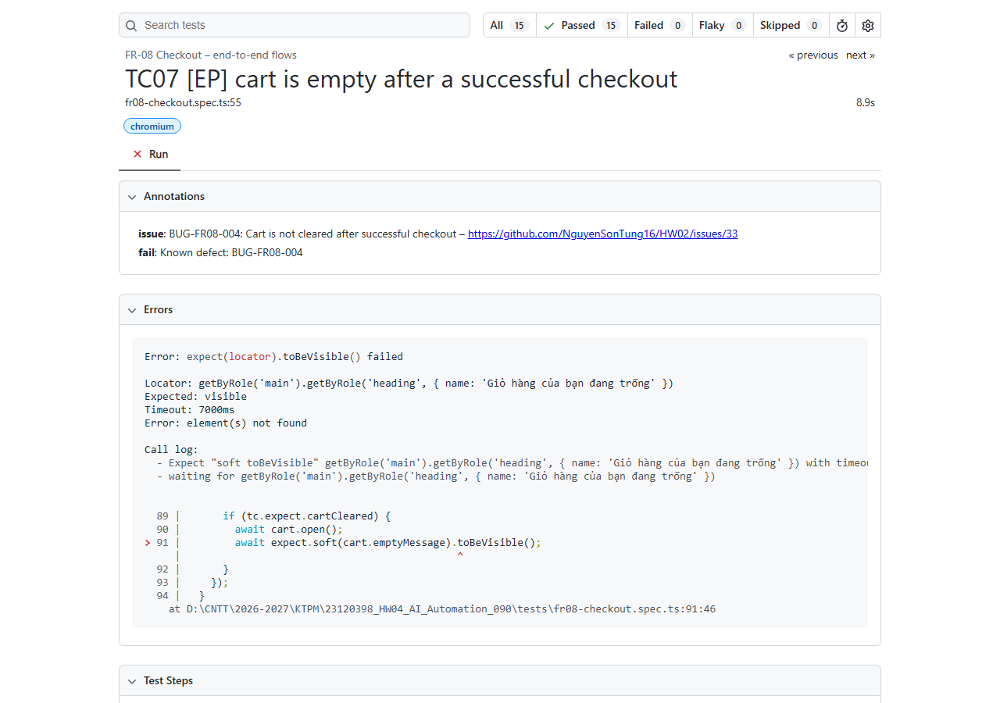

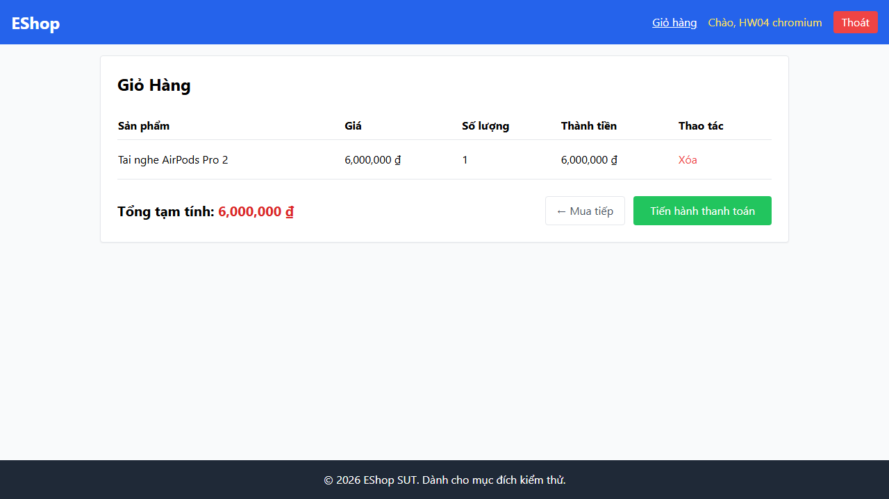

## BUG-FR16-001 – CSV import is not atomic – valid rows are kept when another row fails

- **Feature / component:** FR-16 – Backend API (/api/admin/import-products)
- **Severity:** Critical
- **GitHub issue:** _pending_ (first reported in HW02: https://github.com/NguyenSonTung16/HW02/issues/34)
- **Detected by:** `TC06` in `tests/fr16-*.spec.ts`

**Steps to reproduce**

1. Admin → Sản phẩm → upload data/fr16/mixed-atomic.csv (2 valid rows + 1 row without name)
2. Click "Import 3 sản phẩm"

**Expected:** 0 rows inserted (all-or-nothing).

**Actual:** 2 rows inserted, 1 error reported.

**Root cause:** Rows are inserted one by one without a transaction.

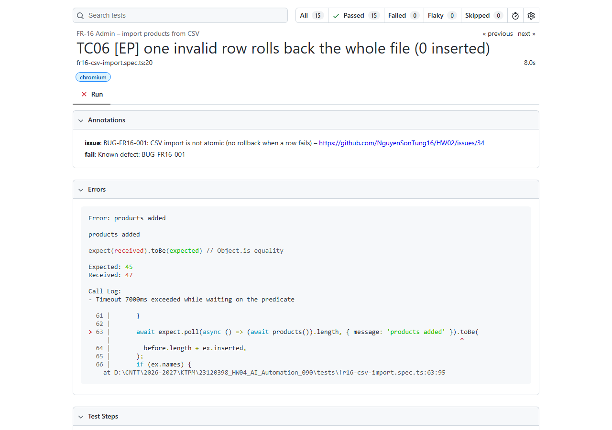

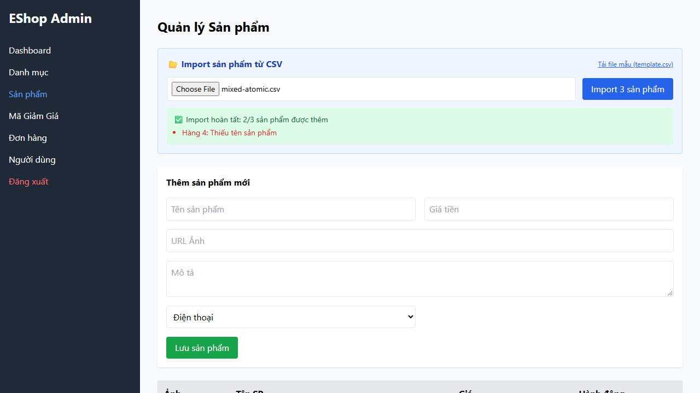

## BUG-FR16-002 – CSV parser splits quoted fields on commas (RFC 4180)

- **Feature / component:** FR-16 – Frontend Admin (CSV parser)
- **Severity:** Critical
- **GitHub issue:** _pending_ (first reported in HW02: https://github.com/NguyenSonTung16/HW02/issues/35)
- **Detected by:** `TC03` in `tests/fr16-*.spec.ts`

**Steps to reproduce**

1. Upload data/fr16/quoted-comma.csv containing `"HW04 Gaming Laptop, 16GB RAM",25000000,…`
2. Import

**Expected:** Product name `HW04 Gaming Laptop, 16GB RAM`.

**Actual:** Product name `"HW04 Gaming Laptop` and the remaining columns shifted.

**Root cause:** `line.split(",")` instead of a CSV parser.

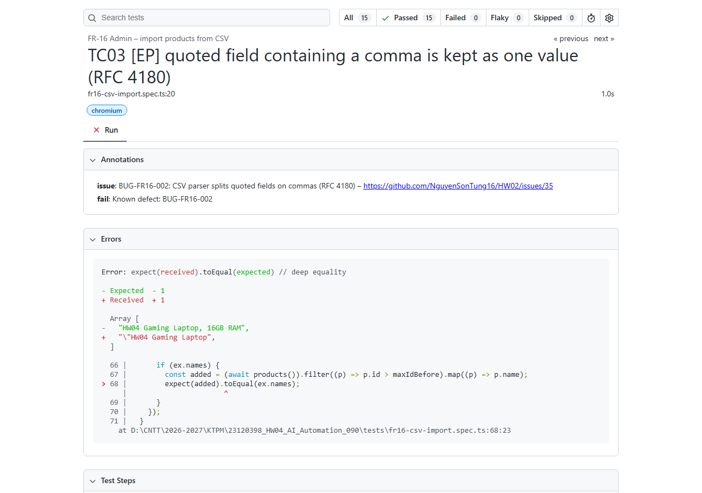

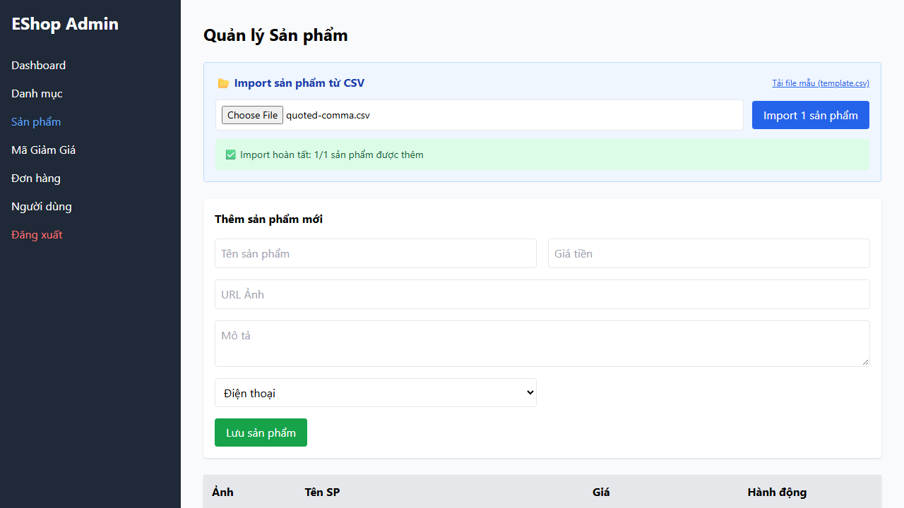

## BUG-FR16-003 – CSV import accepts zero and negative prices

- **Feature / component:** FR-16 – Backend API + Frontend Admin
- **Severity:** High
- **GitHub issue:** _pending_ (first reported in HW02: https://github.com/NguyenSonTung16/HW02/issues/36)
- **Detected by:** `TC05`, `BVA01`, `BVA02` in `tests/fr16-*.spec.ts`

**Steps to reproduce**

1. Upload data/fr16/price-negative.csv (price -10000) or price-zero.csv
2. Import

**Expected:** Row rejected (price must be > 0); 0 products added.

**Actual:** "Import hoàn tất: 1/1 sản phẩm được thêm"; product saved with price -10000 / 0.

**Root cause:** Only `name` is validated.

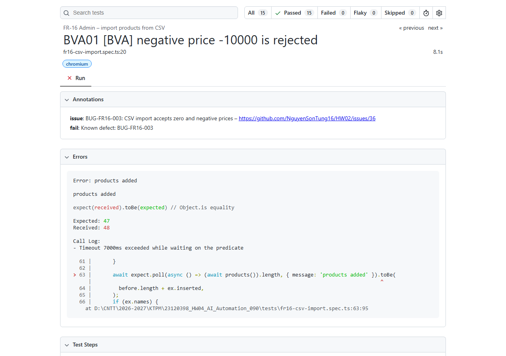

## BUG-FR16-004 – File input has no accept=".csv" restriction

- **Feature / component:** FR-16 – Frontend Admin
- **Severity:** Low
- **GitHub issue:** _pending_ (first reported in HW02: https://github.com/NguyenSonTung16/HW02/issues/37)
- **Detected by:** `TC02` in `tests/fr16-*.spec.ts`

**Steps to reproduce**

1. Admin → Sản phẩm → inspect the import file input

**Expected:** `accept=".csv"`; non-CSV files rejected.

**Actual:** No `accept` attribute; a .txt file is previewed and importable.

**Root cause:** Attribute missing.

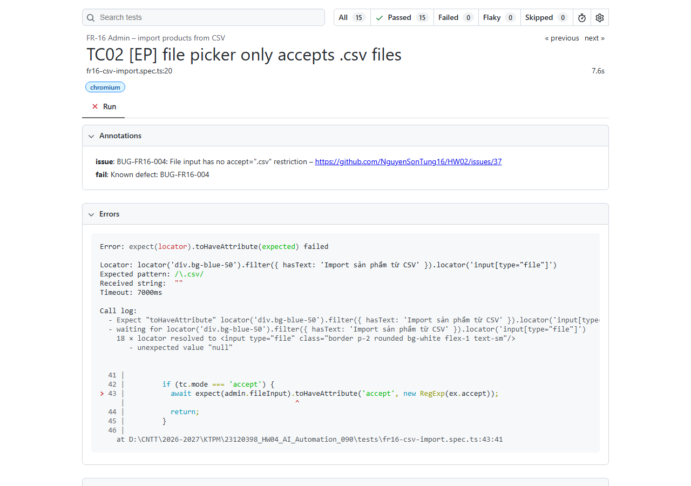

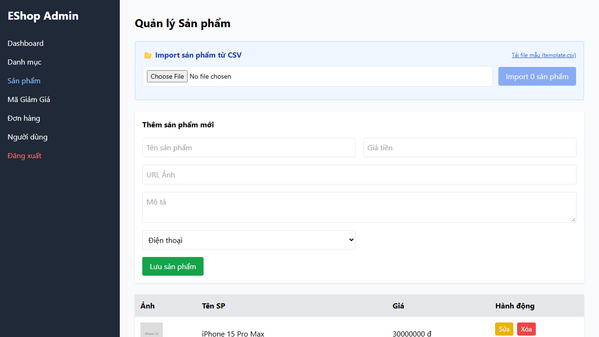

## BUG-FR16-005 – Import API accepts any logged-in user token (no admin role check) – NEW in HW04

- **Feature / component:** FR-16 – Backend API (/api/admin/import-products)
- **Severity:** Critical
- **GitHub issue:** _pending_ – new in HW04
- **Detected by:** `TC11` in `tests/fr16-*.spec.ts`

**Steps to reproduce**

1. Register a normal user and log in (role = user)
2. POST /api/admin/import-products with `Authorization: Bearer <user token>` and the rows of data/fr16/valid.csv

**Expected:** HTTP 403; nothing inserted.

**Actual:** HTTP 200; the products are inserted.

**Root cause:** Route uses `authenticateToken` only and never checks `req.user.role === 'admin'`.

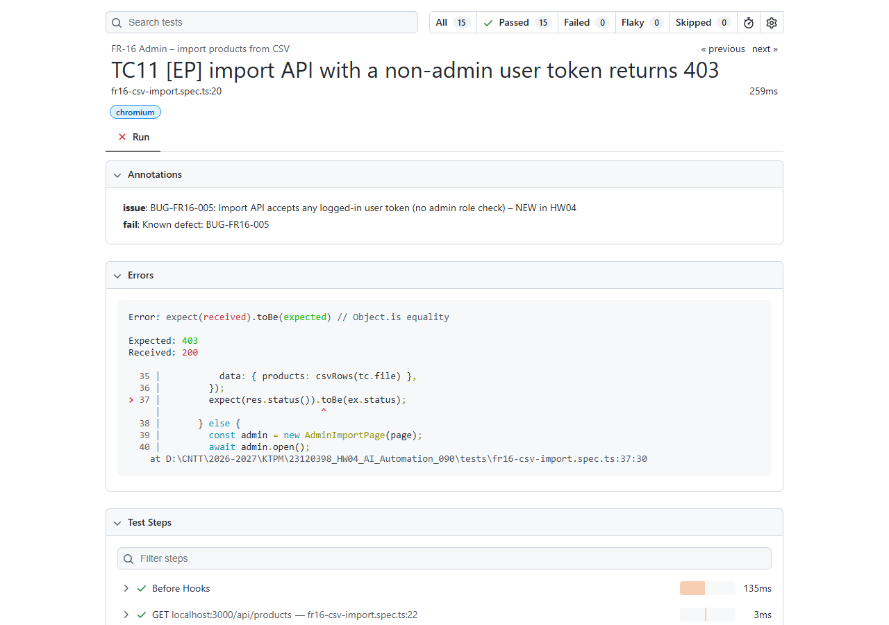

